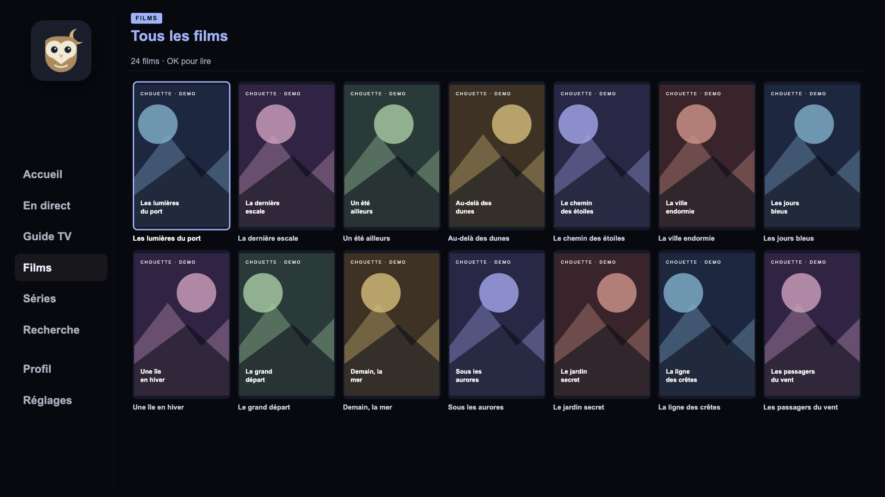
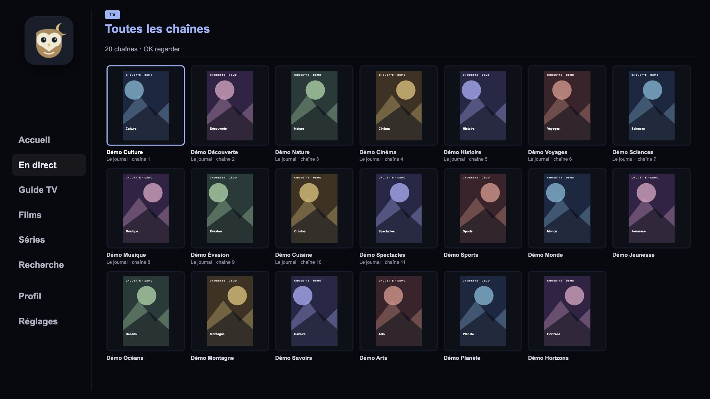
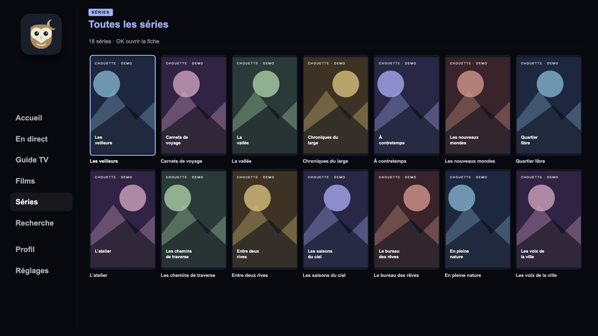
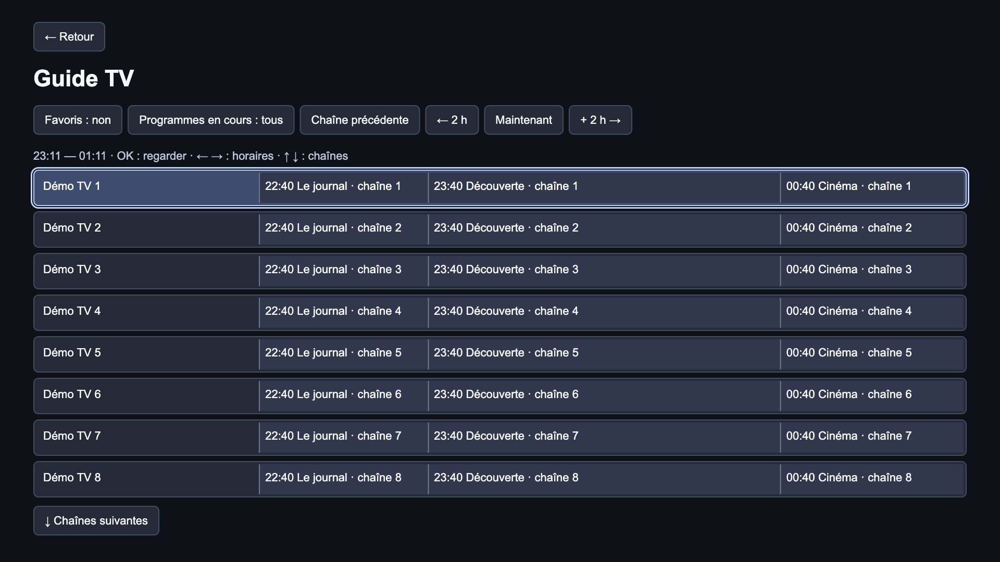

# Chouette TV

An IPTV player for **Samsung Smart TVs running Tizen**, designed for remote-control navigation. Browse live TV, movies and series, explore the programme guide, and keep separate local viewing profiles.

Chouette TV includes **no channels, playlists, subscriptions or source accounts**. Connect your own source in Settings on first launch. The interface is currently in French; this introduction and the installation guide are in English.

[Install on your TV with VS Code](docs/INSTALLATION.md) · [Screenshots](#screenshots) · [Build and customize](#development-and-customization)



## Features

- **Your own sources:** Xtream Codes accounts or M3U/M3U8 playlists with category support.
- **Live TV and guide:** channel browsing, favourites, now/next information and a paginated EPG timeline. Use the source's guide or configure an EPG URL.
- **Movies and series:** search, source-provided details, playback resume, followed series and optional automatic next episodes.
- **Local profiles:** separate viewing history and audio/subtitle preferences.
- **TV controls:** directional navigation, channel switching, aspect ratio, audio tracks, subtitles and playback controls.
- **Custom branding:** another name and artwork from the same application sources, with private configuration outside Git.

## Install on a Samsung TV

Follow the [step-by-step VS Code installation guide](docs/INSTALLATION.md). It covers the Samsung Tizen TV extension, Developer Mode, connecting the TV, creating a Samsung certificate, signing and running the app.

The repository contains source code. The build tool prepares an unsigned Tizen project; signing and installation require your own certificate and TV connection. Playback formats and compatibility depend on the TV model and firmware.

## Screenshots

Browser captures of the actual interface at 1920 × 1080, using `node tests/preview.js --gallery`. The demo contains 20 channels, 24 films and 18 series, with fictional titles and original geometric placeholder artwork. No provider catalogue, third-party posters or real video is included. Grids show the visible portion of each catalogue; use the remote to browse further.

**All channels** — the live catalogue with current programme information.



**All movies** — shown at the top of this page.

**All series** — the series catalogue, with remote-control focus.



<details>
<summary>TV guide — programme timeline and filters</summary>



</details>

## Remote controls

- **Browse:** arrows to navigate, OK to open or play, Back to go up a level.
- **While watching:** OK opens playback controls; arrows and OK select aspect ratio, audio/subtitles or favourites.
- **Live TV:** CH+/CH− switches channels.
- **Movies and episodes:** pause/seek controls; Back closes controls, then returns to browsing.
- **Guide:** Left/Right changes the time window, Up/Down changes the channel, OK starts live playback.

Automatic next episodes are off by default and configurable per profile. Catch-up/replay is not included.

## Sources and local data

Xtream takes priority over a playlist. The app displays a compatible saved catalogue at startup, or loads from the source when no cache is available. **Réglages → Actualiser le catalogue** refreshes it manually. Failed requests preserve available data where possible; unavailable Xtream sections can leave a partial catalogue.

Settings, credentials, profiles and viewing data stay on the device. **Credentials are not encrypted by the application**, and development reinstalls may retain files. See [privacy](docs/PRIVACY.md) (French). No Chouette TV account or project telemetry service is included.

## Development and customization

Node.js 18+ and Bash are sufficient for offline builds and checks; no npm installation is needed:

```sh
git clone https://github.com/ipaifix/chouette-tv.git
cd chouette-tv
bash tools/build-bundle.sh
bash tools/check.sh
node tools/build-variant.js
```

The unsigned project is generated in `dist/chouette-tv/app/`. Open that folder in VS Code for signing and deployment. The output must not already exist; choose a fresh directory for another build.

`branding/public.json` defines the public name, icons, Tizen identity and storage namespace. Copy `branding/custom.example.json` to `private/personal.json` and keep custom assets in the ignored `private/` folder. Build the same sources with another identity:

```sh
node tools/build-variant.js private/personal.json dist/personal/app
```

See [building and branding](docs/BUILDING.md) and [development tools](tools/README.md) (French). Edit `app/js/` modules, then rebuild `app/js/app.bundle.js`. Samsung playback uses AVPlay; browser development uses HTML5 video.

To explore without a provider:

```sh
node tests/preview.js
```

Open the printed local URL and use that URL as the Xtream server with fictional credentials `demo` / `demo`. The demo provides local metadata and artwork without playable video.

## Testing and limitations

Offline tests simulate Tizen/AVPlay. They do not qualify codecs, tracks, standby/resume or full storage on TVs. Incremental catalogue/guide loading and bounded caches limit retained data; actual memory use also depends on the video engine and artwork. Playlist User-Agent overrides are TV-only; M3U Referrer values are not applied by AVPlay.

## Contributing

See [contributing](CONTRIBUTING.md), [security](SECURITY.md) and the [publication checklist](docs/PUBLICATION.md). Keep accounts, private playlists, certificates and device state outside Git. Before sharing sources:

```sh
node tools/privacy-audit.js --history
node tools/prepare-public.js
node tools/privacy-audit.js --tree dist/public-source
```

These tools inspect an explicit public file list. They do not publish or sign packages. Images and documents also require visual review.

## License

[MIT](LICENSE).
